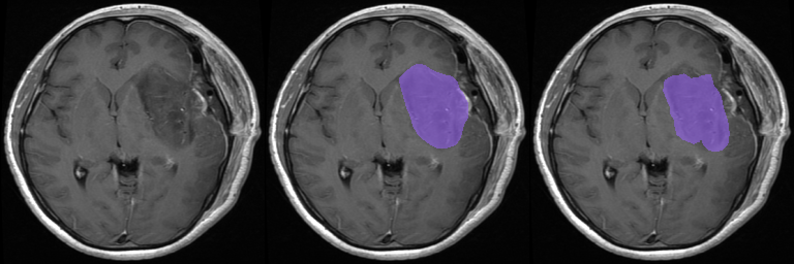

# Two-Level Optimization for Automatic Brain Tumor Segmentation in Magnetic Resonance Imaging

### Gradient descent in a U-Net and meta-optimization of hyperparameters with a genetic algorithm

**Javier Ruano Hernández · Alejandro Delgado Valera**
University of Las Palmas de Gran Canaria · Course *Optimization and Heuristics* · Academic year 2026–2027

**Language:** [Español](README.md) · **English**

[](LICENSE)
[](docs/development.md)
[](docs/development.md)
[](#demo)



*Left: input slice · Center: prediction of model F · Right: the expert's annotation (this glioma slice: Dice 0.87).*

## About this project

This project **automatically segments brain tumors** in magnetic resonance images. Starting from a public dataset of 3,064 contrast-enhanced MRI slices, we train U-Net networks that classify every pixel of the image as background or as one of the three most common tumor types —**meningioma, glioma and pituitary adenoma**—, tune their hyperparameters with a hand-written **genetic algorithm**, and push the final accuracy further with **transfer learning**.

The best model reaches a **mean Dice of 0.825** on the held-out test set (0.134 above the hand-tuned baseline) and powers the interactive demo in this repository.

## Demo

> **Live demo:** *coming soon — it will be published on Streamlit Community Cloud.*

To run it locally:

```bash
git clone https://github.com/oh-j-ruano-a-delgado/optimized-neural-network-tumor-segmentation.git
cd optimized-neural-network-tumor-segmentation
pip install -r requirements.txt
streamlit run app/main.py
```

The demo is **bilingual (English/Spanish)** and requires no medical knowledge: pick one of the example slices or upload your own, compare the two models, see where the tumor was found (color overlay, mask and per-pixel confidence map) and read a plain-language interpretation with the detected tumor type and its relative size.

## Results

| Model | What it is | Best val. Dice | Mean test Dice | Whole-tumor Dice |
|---|---|---:|---:|---:|
| Baseline | Hand-tuned defaults (U-Net, 16 filters) | 0.654 | 0.691 | 0.623 |
| **A** | Genetic-algorithm winner, retrained | 0.770 | 0.776 | 0.723 |
| **E** | Wider U-Net (32 filters) + Focal Tversky + cosine LR | 0.761 | 0.818 | 0.776 |
| **F** | Transfer learning from an ImageNet-pretrained ResNet34 | 0.822 | **0.825** | 0.765 |

*Dice* measures how much the prediction overlaps the expert's annotation (1.00 = perfect). Test figures average meningioma, glioma and pituitary over **592 test slices** from **46 patients** that were never used for training or model selection. The baseline predicts a tumor on 90.7 % of those slices and model A on 93.4 %, both with zero false positives.

Model F is significantly better than E on meningioma (+0.029) but slightly worse on gliomas (−0.028); the full analysis is in the report.

## Why only two models in the demo?

The demo ships **E** and **F**, the two final models of the research:

- **E** is the best model trained from scratch and **F** the best overall; they embody exactly the two conclusions of the project: is it worth widening and retraining the network from scratch, or starting from an already-trained one?
- *Baseline* and *A* were intermediate steps of the same pipeline. They are strictly worse than E and F, so they would only add download weight (~74 MB of checkpoints already included) and slower load times without giving visitors anything new.
- Both models do exactly the same job (the same four classes on 256×256 slices), so the comparison is direct and fair.

Want to add another model? Export its checkpoint with `scripts/export_checkpoint_fp16.py` and register it in `app/segmentation.py`.

## How it works

1. **Data** — 3,064 MRI slices from 233 patients (Figshare), split *by patient* so no patient ever appears in both training and test.
2. **Model** — a U-Net (encoder–decoder) classifies each pixel as background, meningioma, glioma or pituitary.
3. **Loss** — Dice-Focal, and Focal-Tversky in the later models, to compensate for the tumor covering a tiny fraction of each image (majority vs. minority class).
4. **Optimization** — a hand-written genetic algorithm tunes the learning rate, L2 penalty and width/depth of the network, benchmarked against a random search with the same evaluation budget.
5. **Transfer learning** — the final model starts from an ImageNet-pretrained ResNet34 encoder adapted to MRI, with a reduced learning rate for the encoder.

## Dataset

Jun Cheng, *brain tumor dataset*, figshare (2015), <https://doi.org/10.6084/m9.figshare.1512427>
— 3,064 contrast-enhanced T1 slices from 233 patients (708 meningioma, 1,426 glioma, 930 pituitary), licensed [CC BY 4.0](https://creativecommons.org/licenses/by/4.0/). The accompanying papers are Cheng et al., *PLoS ONE* 10(10) (2015) and 11(6) (2016). The dataset is downloaded through the Kaggle mirror `ashkhagan/figshare-brain-tumor-dataset` and is **not redistributed** in this repository.

## Repository layout

```
app/        bilingual Streamlit demo (Spanish/English) with models E and F
src/        data pipeline, U-Net networks, loss functions and genetic algorithm
scripts/    training, optimization, evaluation and plotting
tests/      pytest test suite
docs/       technical guide, README figures
```

## Further reading

- **[docs/development.md](docs/development.md)** — full technical guide: installation, reproducing every result, training options, Streamlit Cloud deployment and Kaggle/Colab execution.
- The **full report (memoria)** accompanies this submission as a separate document; the assignment it responds to is kept in [`bases-proyecto-optimizacionyheuristica.md`](bases-proyecto-optimizacionyheuristica.md).

## Authors

**Javier Ruano Hernández** and **Alejandro Delgado Valera**
University of Las Palmas de Gran Canaria · Course *Optimization and Heuristics* · Academic year 2026–2027 · November 2026

## License

The code in this repository is released under the [MIT License](LICENSE). The dataset is licensed [CC BY 4.0](https://creativecommons.org/licenses/by/4.0/) by its original authors and is **not** redistributed here.

## Medical disclaimer

This is a research and teaching prototype. It is **not** a medical device, it has not been clinically validated, and it must never be used to diagnose, treat or rule out disease. All reported numbers are reproducible experiments on a public dataset.
