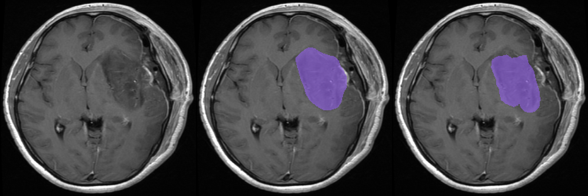

# Optimización en dos niveles para la segmentación automática de tumores cerebrales en resonancia magnética

### Descenso de gradiente en una red U-Net y metaoptimización de hiperparámetros mediante un algoritmo genético

**Javier Ruano Hernández · Alejandro Delgado Valera**
Universidad de Las Palmas de Gran Canaria · Asignatura *Optimización y Heurística* · Curso 2026–2027

**Idioma:** **Español** · [English](README.en.md)

[](LICENSE)
[](docs/development.md)
[](docs/development.md)
[](#demo)



*Izquierda: imagen de entrada · Centro: predicción del modelo F · Derecha: la anotación del experto (este caso de glioma: Dice 0.87).*

## Sobre el proyecto

Este proyecto **segmenta automáticamente tumores cerebrales** en imágenes de resonancia magnética. A partir de un conjunto público de 3.064 cortes de RM con contraste, entrenamos redes U-Net que clasifican cada píxel de la imagen como fondo o como uno de los tres tipos de tumor más frecuentes —**meningioma, glioma e hipófisis**—, optimizamos sus hiperparámetros con un **algoritmo genético** escrito a mano y mejoramos el resultado final con **transfer learning**.

El mejor modelo alcanza un **Dice medio de 0.825** en el conjunto de prueba (0.134 por encima del modelo base, entrenado con ajustes manuales) y es el motor de la demo interactiva de este repositorio.

## Demo

> **Demo en vivo:** *próximamente — se publicará en Streamlit Community Cloud.*

Para probarla en local:

```bash
git clone https://github.com/oh-j-ruano-a-delgado/optimized-neural-network-tumor-segmentation.git
cd optimized-neural-network-tumor-segmentation
pip install -r requirements.txt
streamlit run app/main.py
```

La demo es **bilingüe (español/inglés)** y no requiere conocimientos médicos: elige una imagen de ejemplo o sube la tuya, compara los tres modelos, mira dónde el tumor fue detectado (superposición por color, máscara y mapa de confianza por píxel) y lee la interpretación en lenguaje llano con el tipo de tumor encontrado y su tamaño relativo.

## Resultados

| Modelo | Qué es | Mejor Dice (val.) | Dice medio (test) | Tumor completo (test) |
|---|---|---:|---:|---:|
| Baseline | Ajustes manuales (U-Net, 16 filtros) | 0.654 | 0.691 | 0.623 |
| **A** | Ganador del algoritmo genético, reentrenado | 0.770 | 0.776 | 0.723 |
| **E** | U-Net más ancho (32 filtros) + Focal Tversky + LR cosenoidal | 0.761 | 0.818 | 0.776 |
| **F** | Transfer learning desde una ResNet34 preentrenada | 0.822 | **0.825** | 0.765 |

El *Dice* mide la superposición entre la predicción y la anotación del experto (1.00 = perfecto). Las cifras de test promedian meningioma, glioma e hipófisis sobre **592 cortes de prueba** de **46 pacientes** que nunca se usaron para entrenar ni seleccionar modelos. Además, el modelo base detecta tumor en el 90.7 % de esos cortes y el modelo A en el 93.4 %, ambos sin falsos positivos.

El modelo F es significativamente mejor que E en meningioma (+0.029) pero algo peor en gliomas (−0.028): la tabla completa del análisis está en el informe.

## ¿Qué modelos incluye la demo?

La demo incluye tres puntos de comparación, del más básico al más avanzado:

- **Base (baseline)** — el punto de partida del proyecto: una U-Net pequeña (16 filtros) entrenada con ajustes elegidos a mano. Se incluye como **referencia** para ver de verdad la mejora de los demás modelos (0.691 → 0.825 de Dice medio).
- **E** — el mejor modelo entrenado desde cero: U-Net de 32 filtros con Focal Tversky y LR cosenoidal (0.818).
- **F** — el mejor de todos: parte de una ResNet34 preentrenada en ImageNet (transfer learning, 0.825). Es el que se muestra por defecto.

Las versiones intermedias (el ganador del algoritmo genético y los experimentos de pérdida y aumento de datos) son estrictamente peores que E y F, así que no se incluyen: solo añadirían peso descargado sin aportar nada nuevo a quien visita la demo.

¿Quieres añadir otro modelo? Basta exportar su checkpoint con `scripts/export_checkpoint_fp16.py` y registrarlo en `app/segmentation.py`.

## Cómo funciona

1. **Datos** — 3.064 cortes de RM de 233 pacientes (Figshare), divididos *por paciente* para que ningún paciente aparezca a la vez en entrenamiento y prueba.
2. **Modelo** — una red U-Net (codificador–descodificador) clasifica cada píxel en fondo, meningioma, glioma o hipófisis.
3. **Pérdida** — Dice-Focal, y Focal-Tversky en los últimos modelos, para compensar que el tumor ocupa una fracción mínima de cada imagen (clase mayoritaria vs. minoritaria).
4. **Optimización** — un algoritmo genético propio ajusta la tasa de aprendizaje, la penalización L2 y el ancho/profundidad de la red, y se compara contra una búsqueda aleatoria con el mismo presupuesto de evaluaciones.
5. **Transfer learning** — el modelo final parte de un codificador ResNet34 preentrenado con ImageNet y se adapta a resonancias magnéticas, con una tasa de aprendizaje reducida para el codificador.

## Datos

Jun Cheng, *brain tumor dataset*, figshare (2015), <https://doi.org/10.6084/m9.figshare.1512427>
— 3.064 cortes T1 con contraste de 233 pacientes (708 meningioma, 1.426 glioma, 930 hipófisis), licencia [CC BY 4.0](https://creativecommons.org/licenses/by/4.0/). Los artículos asociados son Cheng et al., *PLoS ONE* 10(10) (2015) y 11(6) (2016). El dataset se descarga a través del espejo de Kaggle `ashkhagan/figshare-brain-tumor-dataset` y **no se redistribuye** en este repositorio.

## Estructura del repositorio

```
app/        demo en Streamlit (español/inglés) con el baseline, los modelos E y F
src/        datos, redes U-Net, funciones de pérdida y algoritmo genético
scripts/    entrenamiento, optimización, evaluación y gráficas
tests/      suite de pruebas (pytest)
docs/       guía técnica, figuras del README
```

## Más información

- **[docs/development.md](docs/development.md)** — guía técnica completa: instalación, reproducción de todos los resultados, opciones de entrenamiento, despliegue en Streamlit Cloud y ejecución en Kaggle/Colab.
- El **informe completo (memoria)** acompaña esta entrega como documento aparte; el enunciado de la práctica está en [`bases-proyecto-optimizacionyheuristica.md`](bases-proyecto-optimizacionyheuristica.md).

## Autores

**Javier Ruano Hernández** y **Alejandro Delgado Valera**
Universidad de Las Palmas de Gran Canaria · Asignatura *Optimización y Heurística* · Curso 2026–2027 · Noviembre de 2026

## Licencia

El código de este repositorio se publica bajo la [licencia MIT](LICENSE). El dataset está bajo [CC BY 4.0](https://creativecommons.org/licenses/by/4.0/) de sus autores originales y **no** se redistribuye aquí.

## Aviso médico

Este es un prototipo de investigación y docencia. **No** es un dispositivo médico, no ha sido validado clínicamente y nunca debe usarse para diagnosticar, tratar o descartar una enfermedad. Todas las cifras son experimentos reproducibles sobre un conjunto de datos público.
